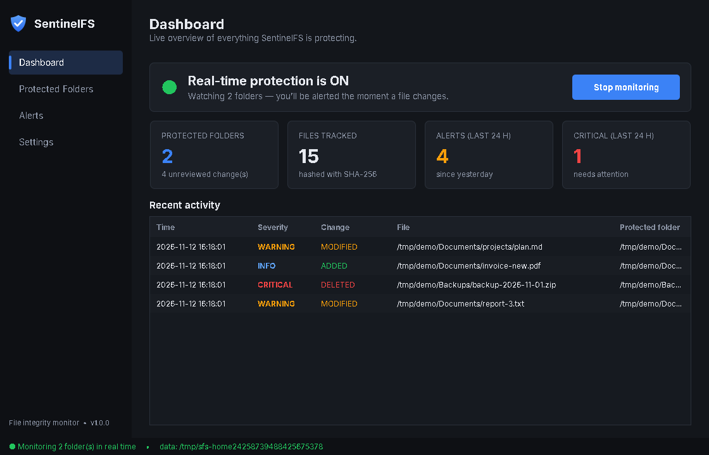
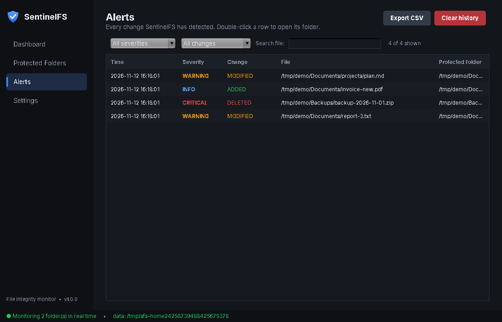

# SentinelFS

**File integrity monitor with a desktop app.** SentinelFS remembers what your important folders look like (a SHA-256 fingerprint of every file), then watches them in real time and alerts you the moment a file is modified, added or deleted — so tampering, ransomware, accidental deletes and silently corrupted backups don't go unnoticed.



## Download

Grab the latest build from the **[Releases page](../../releases/latest)**:

| You are on | Download | How to run |
|---|---|---|
| **Windows** | `SentinelFS-x.y.z-windows.zip` | Unzip, open the `SentinelFS` folder, double-click **SentinelFS.exe** |
| **macOS** | `SentinelFS-x.y.z-macos.zip` | Unzip, right-click **SentinelFS.app → Open** (first time only; the app is unsigned) |
| **Linux** | `SentinelFS-x.y.z-linux.tar.gz` | `tar xzf` it, run `SentinelFS/bin/SentinelFS` |
| **Any OS with Java 21+** | `SentinelFS-x.y.z.jar` | `java -jar SentinelFS-x.y.z.jar` |

The zip/tar downloads bundle their own Java runtime — nothing else to install. On Windows, SmartScreen may warn about an unsigned app: *More info → Run anyway*.

## Using it

1. **Protected Folders → + Add folder.** Pick a folder and say what it holds (general files, archived logs, or backups). SentinelFS hashes everything and saves a sealed baseline.
2. **Dashboard → Start monitoring.** From now on any change is reported instantly, shown in the app, written to history, and (if the window is hidden) pushed as a desktop notification from the system tray.
3. **Review.** *Alerts* lists everything (filter, search, export CSV, double-click to open the folder). *Scan* on a folder shows exactly what differs from the baseline; if the changes are legitimate click **accept as new baseline**.

Handy settings: ignore patterns (`*.tmp`, `node_modules`, …), a periodic safety-net scan, start-on-launch, run-in-tray.



### Severity
| Change | General folder | Logs / Backups folder |
|---|---|---|
| File added | INFO | INFO |
| File modified | WARNING | **CRITICAL** |
| File deleted | WARNING | **CRITICAL** |
| Baseline file tampered with | **CRITICAL** | **CRITICAL** |

### Console mode
Prefer a terminal (or a server with no display)? `java -jar SentinelFS-x.y.z.jar --cli` offers the same engine as a text menu. It is chosen automatically when no display is available.

## How it works

- **Fingerprints** – every file is hashed with SHA-256 (streamed, so big files are fine) and hashed in parallel on multi-core machines.
- **Real-time** – Java's `WatchService` delivers OS file events. Events are only a hint: a changed file is re-hashed after a short debounce and compared with the trusted baseline. Edit-then-revert produces no alert, duplicate Windows events collapse into one, new sub-folders are picked up automatically, and an event overflow triggers a full rescan.
- **Sealed baselines** – each baseline is saved with an HMAC-SHA256 seal. If someone edits the baseline to hide a change (or deletes the seal) SentinelFS reports `BASELINE_TAMPERED` instead of trusting it.
- **Observer-pattern alerts** – detection fires events; the UI, the plain-text `alerts.log`, the persistent JSON history and tray notifications are independent listeners. Adding e-mail/Slack later is one new class.

Data lives in `~/.sentinelfs` (`config.json`, `baselines/`, `alert-history.jsonl`, `alerts.log`). Override with `-Dsentinelfs.home=<dir>`.

### Honest limitations
- The HMAC key sits on the same machine. The seal catches accidental damage and casual tampering, but an attacker who already runs as *your user* can read the key and re-seal a forged baseline. For stronger guarantees keep the baseline/key on read-only or remote media (see roadmap).
- SentinelFS detects and alerts; it doesn't block writes or restore files.
- On macOS the JDK's file watcher polls (≈10 s delay) instead of using native events.

## Build from source

Requires JDK 21+ and Maven.

```bash
mvn verify                      # compile + run tests + build the fat jar
java -jar target/SentinelFS-1.0.0.jar
```

Project layout:

```
com.sentinelfs.core       FileRecord, HashingUnit
com.sentinelfs.config     settings, data folder, protected-folder model
com.sentinelfs.baseline   sealed JSON baselines (Gson + HMAC)
com.sentinelfs.integrity  scanning, ignore patterns, baseline comparison
com.sentinelfs.watch      continuous real-time watcher
com.sentinelfs.alert      events, severities, listeners (console, log file, history)
com.sentinelfs.service    MonitorService – the engine both front-ends drive
com.sentinelfs.gui        Swing desktop UI (dark theme, no extra libraries)
com.sentinelfs.ui         console front-end
```

## Releasing a new version (maintainers)

See [docs/PUBLISHING.md](docs/PUBLISHING.md). In short: `git tag v1.0.0 && git push origin v1.0.0` — GitHub Actions builds every download and publishes the release.

## Roadmap ideas
- E-mail / Slack / Telegram alert listeners
- Optional "who changed it" process info on Windows (ETW) / Linux (auditd)
- Export baseline + key to removable media; verify against a remote copy
- Signed installers (MSI / DMG / DEB) and auto-update check
- HTML/PDF integrity reports and a scheduled-report e-mail
- Per-file allow-lists for files that legitimately change often

## License
MIT — see [LICENSE](LICENSE).
